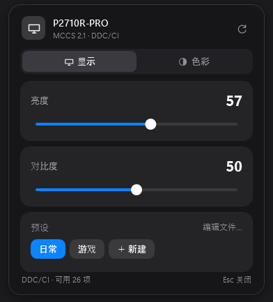
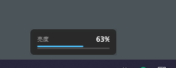
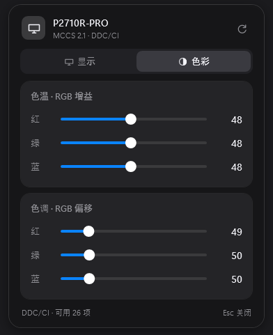

# MonitorBar

Windows 任务栏托盘里的显示器控制面板。点托盘图标弹出深色玻璃质感的小面板，直接调**亮度 / 对比度 / RGB 色温与色调**，并一键切换自己写的**预设**。

纯原生实现：.NET Framework + WPF + `dxva2.dll`（VESA MCCS over DDC/CI）。不用驱动、不用管理员、不联网、无第三方运行时，编译产物约 52 KB。



**把鼠标悬停在托盘图标上滚动滚轮，可以直接调亮度**，右下角弹出与系统音量条同款的小提示：



---

## 功能

- **滚轮调亮度**：光标停在托盘图标上滚一格，亮度 ±3，带 OSD 提示
- **亮度 / 对比度**：拖动即时生效，写入做了合并与节流
- **色温 · RGB 增益**：红 / 绿 / 蓝 三条独立滑块（VCP `0x16` `0x18` `0x1A`，0–100）
- **色调 · RGB 偏移**：红 / 绿 / 蓝 三条独立滑块（VCP `0x6C` `0x6E` `0x70`，0–255）
- **可自写预设**：只联动对比度与色彩，不动亮度；适合在「日常」「游戏」之间快速切换
- 开机自启、单实例、休眠唤醒后自动重新枚举显示器

| 色彩页 |
|---|
|  |

## 下载

到 [Releases](../../releases) 下载 `MonitorBar.exe`，双击即可运行，图标出现在任务栏右下角（可能在 `^` 溢出区，拖到任务栏上固定即可）。

## 预设：自己写，只影响对比度和色彩

预设文件：`%LOCALAPPDATA%\MonitorBar\presets.txt`，一行一个，`#` 开头是注释：

```
# 名称|对比度(0-100)|红增益|绿增益|蓝增益|红偏移|绿偏移|蓝偏移   (偏移 0-255)
日常|50|48|48|48|49|50|50
游戏|62|52|50|48|50|50|50
```

保存后下次打开面板生效。面板内也可以维护：

| 操作 | 效果 |
|---|---|
| 左键点预设 | 应用（不改亮度） |
| 右键点预设 | 用当前设置覆盖 / 重命名 / 删除 |
| ＋ 新建 | 把当前对比度与色彩存成新预设 |
| 编辑文件… | 用记事本打开 `presets.txt` |

当前参数与某预设一致时，该预设高亮成蓝色。

## 安装

```powershell
# 便携运行
.\dist\MonitorBar.exe

# 安装到 %LOCALAPPDATA%\MonitorBar，建开始菜单快捷方式并启动
powershell -ExecutionPolicy Bypass -File .\install.ps1

# 同时设置开机启动
powershell -ExecutionPolicy Bypass -File .\install.ps1 -Autostart
```

右键托盘图标可开关「开机自动启动」。

## 原理

显示器面板按钮背后是标准总线 **VESA MCCS over DDC/CI**（I²C），Windows 从 Vista 起用 `dxva2.dll` 封装好了：

| 功能 | VCP | 调用 |
|---|---|---|
| 亮度 | `0x10` | `GetMonitorBrightness` / `SetMonitorBrightness` |
| 对比度 | `0x12` | `GetVCPFeatureAndVCPFeatureReply` / `SetVCPFeature` |
| 色温 RGB 增益 | `0x16` `0x18` `0x1A` | 同上 |
| 色调 RGB 偏移 | `0x6C` `0x6E` `0x70` | 同上 |

启动时读一次 capability string 得到型号和支持的 VCP 列表，缓存到 `identity.txt`，之后打开面板是瞬时的。

滚轮功能使用全局低级鼠标钩子（`WH_MOUSE_LL`），只有光标落在托盘图标矩形内时才拦截滚轮；图标矩形由 UI Automation 查询任务栏得到，每 2 秒刷新一次。

## 构建

只需要 Windows 自带的 C# 编译器（`csc.exe` 4.8），无 SDK、无 NuGet：

```powershell
powershell -ExecutionPolicy Bypass -File .\build.ps1
# => dist\MonitorBar.exe
```

源码是单文件 `src/MonitorBar.cs`，使用 C# 5 语法以兼容系统自带编译器。

开发用参数：

```powershell
MonitorBar.exe --render out.png                 # 离屏渲染「显示」页（不弹窗）
MonitorBar.exe --render out.png --tab color     # 离屏渲染「色彩」页
MonitorBar.exe --set 0x10=45                    # 无界面直接写一个 VCP 值
```

## 已知限制

- 只控制**第一台**支持 DDC/CI 的显示器
- 滚轮只在图标可见时生效；被收进 `^` 溢出区时拖到任务栏固定即可
- 部分显示器的饱和度 / 色相（`0x8A` / `0x90`）固件未实现，本工具不提供这两项
- RGB 增益通常只在显示器「用户」色彩预设下生效

## 卸载

退出托盘程序，删除 `%LOCALAPPDATA%\MonitorBar`，并删除注册表 `HKCU\Software\Microsoft\Windows\CurrentVersion\Run` 下的 `MonitorBar` 值（如开过自启）。

## License

[MIT](LICENSE)
